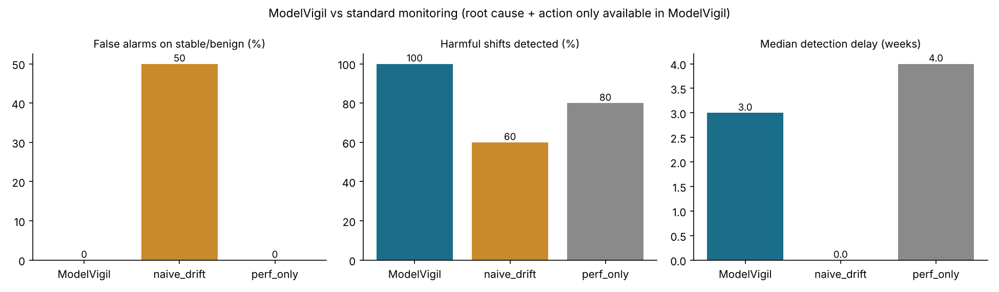

<h1 align="center">ModelVigil 🩺📈</h1>

<p align="center"><b>Agentic post-market surveillance for clinical prediction models</b></p>

<p align="center">
  
  
  
  
  
  
  <br>
  
  
  
  <br>
  
  
  
  
  <br>
  
  
  
  
</p>

ModelVigil watches a deployed hospital risk model, a 48-hour clinical-deterioration score, after it goes live. It detects degradation **before outcome labels arrive**, works out **why** performance changed, proposes a fix that has been shadow-tested and stays inside a pre-agreed change-control plan, sends the fix through human approval, and writes an EU AI Act Art. 72-style post-market monitoring report backed by a tamper-evident audit trail.

> ⚠️ **Research prototype only. Not a medical device.** It runs on synthetic data and must not be used for clinical decision-making or as regulatory advice. See [Limitations](#limitations).

<p align="center"></p>

```
python -m modelvigil run --scenario lab_unit_change

[ModelVigil] scenario=lab_unit_change seed=7 | baseline AUROC 0.876, alert rate 21.2%
  week  5  INCIDENT INC-LAB_-05: DQ_RANGE:lactate, DRIFT_MULTIVARIATE
           diagnosis: unit_change (high, verified=True)
           action: data_pipeline_fix -> APPROVED by PCCP policy (pre-authorised change)
```

---

## The problem

Clinical prediction models degrade silently after deployment. The best-known example is Epic's widely deployed sepsis model. External validation found AUROC 0.63, far below what the developer reported. It missed 67% of sepsis cases while alerting on 18% of all hospitalisations ([Wong et al., *JAMA Intern Med* 2021](https://pmc.ncbi.nlm.nih.gov/articles/PMC8627243)). The rest of the field has the same structural problems:

| Open gap | Why it matters |
|---|---|
| **Labels arrive late.** Outcomes such as ICU transfer or death need chart review, so performance can't be checked in real time. | A model can be broken for weeks before anyone can measure it. |
| **Detectors flag drift but rarely its cause.** Root-cause analysis is rare, and fixes are applied without a diagnosis ([review, 2025](https://arxiv.org/pdf/2506.17442)). | A lab unit change, a flu season and a new care bundle need completely different fixes. |
| **Benign and harmful shift are not separated.** | Drift dashboards cry wolf. Teams mute them or switch the model off. |
| **Subgroup blind spots.** Overall metrics hold while one site or population is under-triaged. | Equity and patient-safety failures go unseen. |
| **Agentic AI in health has no monitoring story.** A 2026 *npj Digital Medicine* scoping review found **none** of the included agentic systems described continuous drift monitoring, and only one involved real patients ([npj Digit Med 2026](https://www.nature.com/articles/s41746-026-02517-5)). | Agents are being proposed for clinical workflows with no lifecycle governance. |

Regulation now requires this work. The EU AI Act obliges providers of high-risk AI to run a **post-market monitoring system** (Art. 72) and report serious incidents (Art. 73). After the Digital Omnibus, these obligations apply from **2 Dec 2027** for Annex III systems and **2 Aug 2028** for AI embedded in regulated products such as medical devices ([White & Case](https://www.whitecase.com/insight-alert/eu-ai-omnibus-enters-force-amending-ai-act)). In the US, FDA's Predetermined Change Control Plans and its 2025 call for input on measuring real-world performance of AI-enabled devices point the same way ([Fenwick summary](https://www.fenwick.com/insights/publications/fda-requests-public-comment-on-how-to-measure-and-manage-performance-of-ai-enabled-medical-devices)).

## What ModelVigil does

There are four agents. Each has a narrow job.

| Agent | Kind | Job |
|---|---|---|
| **Monitor** | deterministic, weekly | **Label-free checks:** data quality by site (physiological range, single-value imputation spikes), a multivariate drift test (classifier two-sample), alert burden, **confidence-based expected AUROC** (CBPE), and new subgroups. **Label-based checks** on lagged outcomes: AUROC (Hanley–McNeil SE), O/E with an exact Poisson CI, calibration slope, and subgroup O/E with Bonferroni limits. Label signals must persist for two looks (SPC run rule). |
| **Diagnostician** | **agentic** (Claude via tool use, or a scripted offline policy) | Tests root-cause hypotheses, cheapest and most actionable first. Pipeline faults are ruled out first, then the question is whether the problem is local or global, then concept shift versus prevalence shift. It picks which tool to call next and explains the evidence. |
| **Verifier** | deterministic | Re-runs the tests independently. If the LLM claims a cause the evidence doesn't support, the claim is **rejected and logged**, and the scripted reference policy takes over. |
| **Remediation** | deterministic | Builds candidate fixes and **shadow-evaluates** them on held-out recent outcomes: a pipeline correction (verified by re-testing the fault on the corrected batch), intercept or logistic recalibration, **model revision** (step 3 of Steyerberg's updating hierarchy), full refit, or site-specific recalibration. |
| **Governance** | deterministic + human | Checks the **PCCP envelope** (recalibration within bounds and pipeline fixes are pre-authorised; retraining and subgroup restriction need clinical-safety review). Runs the approval gate (`policy` / `interactive` / `auto`), sets the vigilance flag, writes the hash-chained audit log, and drafts the PMS report. |

**Design rule:** the LLM decides *which question to ask next* and explains the answer. It never computes a statistic, never changes the model, and its conclusions are checked independently.

### Methods worth noting

- **Differential concept-shift test.** Concept shift is tested with a model-revision likelihood-ratio test that is *differential*. It asks whether a feature's residual association with the outcome (beyond the model's logit) has **changed** relative to the reference cohort. A period main effect and a logit × period term are included, so a pure prevalence shift or a change in calibration slope is not mistaken for concept shift. Without this, ordinary model misspecification triggers false "concept shift" diagnoses.
- **Change-point estimation.** Before diagnosis, a single change-point Poisson likelihood-ratio test on weekly O/E picks out the post-change weeks. Mixing pre- and post-change weeks dilutes every test.
- **Local vs global.** A subgroup is only blamed if two things hold: excluding it brings the rest of the population back into control, and its O/E differs significantly from the rest (heterogeneity z-test). A prevalence shift lifts every subgroup, and this test stops it being misread as several local problems.
- **Prospective verification.** After any model change, only outcomes for patients scored *after* the change count toward monitoring. Label-free score baselines are re-anchored to the new configuration.
- **Impact.** Patient-level impact is measured as decision-curve **net benefit** at the deployed threshold, not just sensitivity. Most fixes trade missed deteriorations against alert fatigue, and net benefit puts a price on that trade.

## Benchmark

There are seven injected scenarios. Each has a known root cause and a known correct action. The benchmark compares ModelVigil with two standard monitoring approaches: a *drift dashboard* (any univariate KS test or classifier two-sample AUROC > 0.60) and a *periodic performance audit* (lagged AUROC / O/E control limits, with the same two-look rule).

| Scenario | What happens | Truth → correct action |
|---|---|---|
| `stable` | nothing | none |
| `benign_covariate` | older, more comorbid case-mix; the model is still well specified | benign → **no change** |
| `lab_unit_change` | site B's lab system switches lactate to mg/dL, which floods the wards with alerts | unit change → pipeline fix |
| `feed_outage` | site C's SpO₂ feed drops half its readings and the interface engine back-fills 97%, masking hypoxia | feed outage → pipeline fix |
| `prevalence_shift` | viral season raises risk through factors the model can't see; inputs look unchanged | prevalence shift → recalibrate |
| `concept_shift` | a lactate-triggered sepsis bundle reverses the lactate–outcome relationship | concept shift → retrain / model revision (review) |
| `subgroup_site` | a renal unit (site D) joins; creatinine carries far more risk there | subgroup degradation → restrict + local recalibration (review) |

**Results: 7 scenarios × 8 seeds = 56 runs** (`python -m modelvigil benchmark --seeds 8`):

| Method | False alarms (stable + benign) | Harmful shifts detected | Median delay (weeks) | Root cause correct | Correct action |
|---|---|---|---|---|---|
| **ModelVigil** | **0%** | **100%** | 3.0 | **100%** | **100%** |
| Drift dashboard | 50% | 60% | 0.0 | — | — |
| Performance audit | 0% | 80% | 4.0 | — | — |

The overall delay of 3 weeks hides the split. Pipeline faults are caught **in the week they start (delay 0)**, using label-free checks alone. Prevalence and concept shifts are invisible to label-free methods, because the inputs don't change. They are caught as soon as the 2-week label lag and the two-look rule allow (≈4 weeks). The drift dashboard is fast but cannot tell benign from harmful shift (50% false alarms) and misses shifts that leave the inputs unchanged.



Patient-level impact after the shift (simulation oracle, totals across 8 seeds):

| Scenario | Missed deteriorations (none → ModelVigil) | False alerts (none → ModelVigil) | Net benefit /1000 (none → ModelVigil) |
|---|---|---|---|
| lab_unit_change | 1624 → 2001 | 9831 → **6462** | 50.4 → **58.5** |
| feed_outage | 2434 → **2187** | 5443 → 5955 | 55.4 → **57.5** |
| prevalence_shift | 4178 → **3183** | 4467 → 7060 | 96.0 → **102.0** |
| concept_shift | 1830 → 2169 | 8067 → **5975** | 17.9 → **21.1** |
| subgroup_site | 4318 → **2773** | 5320 → 7977 | 97.7 → **113.0** |

Every fix improves net benefit, but the direction of the trade differs by root cause. Correcting an alert flood (unit change) or an over-predicting model (concept shift) removes thousands of false alerts at the cost of some sensitivity. Correcting under-prediction (prevalence shift, the renal site) catches more deteriorations at the cost of more alerts. That is why the root cause, rather than a generic "retrain", has to drive the action.

Full tables: [`results/benchmark_summary.md`](results/benchmark_summary.md). A sample report: [`examples/subgroup_site_s7/pms_report.md`](examples/subgroup_site_s7/pms_report.md).

## Quick start

```bash
pip install -r requirements.txt

python -m modelvigil list                                  # scenarios + ground truth
python -m modelvigil run --scenario subgroup_site          # one run -> runs/subgroup_site_s7/
python -m modelvigil run --all                             # every scenario
python -m modelvigil run --scenario concept_shift --approval interactive   # you are the safety officer
python -m modelvigil benchmark --seeds 8                   # ~8 min on 2 cores
python -m modelvigil verify-audit runs/subgroup_site_s7/audit.jsonl
pytest -q
```

Each run writes `pms_report.md`, `timeline.png`, `result.json` (including the full agent trace) and `audit.jsonl`.

### Using Claude as the Diagnostician

```bash
pip install anthropic
export ANTHROPIC_API_KEY=...
# optional: export MODELVIGIL_MODEL=<model id>
python -m modelvigil run --scenario concept_shift --llm anthropic
```

The agent receives the tools as Anthropic tool-use schemas, investigates in a loop, and has to finish with `submit_diagnosis`. That diagnosis is re-verified before anything acts on it. The offline `mock` backend speaks the same protocol, so CI and the benchmark run without a key. A test checks that an LLM asserting an unsupported cause is overruled.

## Repository layout

```
modelvigil/
  config.py        feature dictionary (LOINC-coded), thresholds, PCCP envelope
  simulator.py     synthetic hospital + 7 failure scenarios with ground truth
  model.py         GBM + Platt deterioration model; immutable versioning; recalibration / revision
  detectors.py     label-free + label-based monitoring statistics
  diagnostics.py   root-cause hypothesis tests
  remediation.py   pipeline corrections, update candidates, shadow evaluation, PCCP check
  agents.py        Monitor, Diagnostician (+ verifier), Remediation, Governance
  llm.py           Anthropic tool-use backend + offline mock backend
  engine.py        weekly surveillance loop, oracle impact
  report.py        PMS report + timeline figure
  audit.py         hash-chained audit log
  benchmark.py     scenarios x seeds vs baselines
tests/             unit, hypothesis, governance, LLM-safety and end-to-end tests
```

## Toward real data

Features use FHIR Observation semantics with LOINC codes (`config.FEATURES`). To monitor a real model, replace `HospitalStream` with an adapter that yields weekly batches (features + `site`, `sex`, `age_band`, and `y` once adjudicated) and wrap your model in `ModelVersion`. MIMIC-IV and eICU-CRD are natural public testbeds, for example a temporal split across years or a cross-hospital split in eICU.

## Limitations

- **Synthetic data.** Every scenario has one clean, injected cause. Real incidents overlap, for example a pipeline fault during flu season. The perfect benchmark scores reflect a well-specified simulator, not proof of real-world performance.
- **CBPE assumes covariate shift and a calibrated model.** By design it is blind to prevalence and concept shift, which is why lagged labels remain essential.
- **The clinical safety officer is simulated** in `policy` mode: it accepts a change when the shadow evaluation shows it is non-inferior. Use `--approval interactive` to make the decision yourself.
- The `subgroup_restriction` recommendation (suspend autonomous alerting at a site) is recorded but not simulated as a workflow change.
- This is a research and portfolio demonstrator. It is not a medical device and not regulatory advice.

## References

- Wong A. et al. External validation of a widely implemented proprietary sepsis prediction model. *JAMA Intern Med* 2021.
- Steyerberg E.W. *Clinical Prediction Models* (2nd ed.), ch. 20: updating hierarchy (recalibration → revision → refit).
- Vickers A.J., Elkin E.B. Decision curve analysis. *Med Decis Making* 2006.
- Hanley J.A., McNeil B.J. The meaning and use of the area under a ROC curve. *Radiology* 1982.
- Rabanser S. et al. Failing loudly: an empirical study of methods for detecting dataset shift. *NeurIPS* 2019.
- Keeping medical AI healthy: detection and correction of system degradation. arXiv:2506.17442.
- The role of agentic AI in healthcare: a scoping review. *npj Digit Med* 2026.
- Regulation (EU) 2024/1689 (AI Act), Arts. 12, 72, 73; Regulation (EU) 2017/745 (MDR), Arts. 83–87.

## License

MIT © 2026 Sanaz Jamalzadeh
