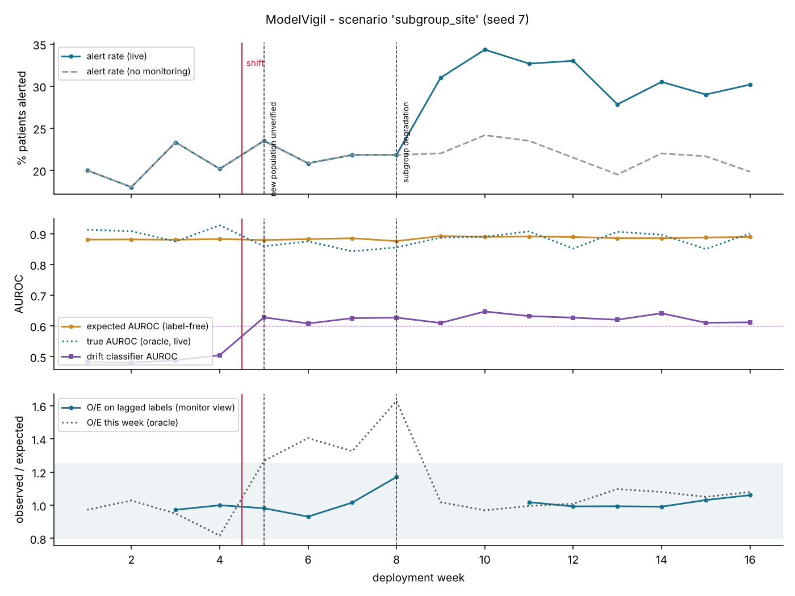

# Post-Market Monitoring Report - 48h Deterioration Model

*Generated by ModelVigil. Scenario `subgroup_site` (synthetic data), seed 7, diagnostician backend `mock`, approval mode `policy`.*

> Structure follows the post-market monitoring obligations of the EU AI Act (Art. 72) and MDR post-market surveillance (Arts. 83-86). It is a technical demonstrator, not a regulatory submission.

## 1. System under surveillance

- Intended use: flag adult inpatients at risk of unplanned ICU transfer or death within 48 h; alert at risk >= 20% triggers rapid-response review.
- Initial version 1.0.0; final version **1.1.0** (site-D logistic recalibration (a=+1.633, b=1.021)), fingerprint `981f9d067928`.
- Validation baseline: AUROC 0.876, O/E 0.92, alert rate 21.2%.
- Monitoring period: 16 weeks, ~600 patients/week; outcomes available after a 2-week lag.

## 2. Monitoring plan in force

- Label-free (weekly): data quality (physiological range, single-value spikes by site), multivariate drift (classifier two-sample test), alert burden, confidence-based expected AUROC, new subgroups.
- Label-based (lagged, rolling): AUROC, O/E with exact Poisson CI, calibration slope, subgroup O/E (site, sex, age band) with Bonferroni-adjusted limits.
- Change control (PCCP): pre-authorised = recalibrate_intercept, recalibrate_logistic, data_pipeline_fix, enhanced_surveillance, no_change; review required = retrain, subgroup_restriction, rollback.

## 3. Incidents

### INC-SUBG-05 - opened week 5

**Triggering signals:** `DRIFT_MULTIVARIATE`, `NEW_SUBGROUP:site=D`

**Root cause:** `new_population_unverified` (confidence medium; independently verified: yes; backend mock)

Model performance in this population is unknown until outcomes arrive. Enhanced surveillance with prioritised outcome review.

Evidence:
- site=D appeared (30% of patients); most shifted features: creatinine, temp, wbc

**Investigation trace:** `get_incident_signals` -> `check_unit_mismatch` -> `check_imputation_artifact` -> `check_new_population` -> `submit_diagnosis`

**Proposed action:** `enhanced_surveillance` (category `enhanced_surveillance`)
- Prioritise outcome chart review for site=D
- Lower subgroup alarm thresholds until performance is confirmed

**PCCP:** inside envelope - all PCCP conditions met

**Decision:** APPROVED by PCCP policy (pre-authorised change)

### INC-SUBG-08 - opened week 8

**Triggering signals:** `SUBGROUP:site=D`

**Root cause:** `subgroup_degradation` (confidence high; independently verified: yes; backend mock)

Miscalibration is confined to one subgroup; the rest of the population is in control, so a global fix would be wrong.

Evidence:
- site=D: O/E 2.1845 (z=9.14), sensitivity 0.6, 52 missed events
- Remaining population O/E 0.8648 - in control

Labelled weeks used for diagnosis: [5, 6] (change-point)

**Investigation trace:** `get_incident_signals` -> `check_unit_mismatch` -> `check_imputation_artifact` -> `localise_subgroups` -> `submit_diagnosis`

**Proposed action:** `subgroup_restriction` (category `subgroup_restriction`)
- Suspend autonomous alerting for site=D; revert to standard early-warning score there
- Interim after sign-off: site-D logistic recalibration (a=+1.633, b=1.021)
- Commission local validation for site=D before re-enabling
- Candidate model 1.1.0: site-D logistic recalibration (a=+1.633, b=1.021)

Shadow evaluation on held-out recent labelled data:

| config | AUROC | O/E | Brier | sensitivity | alert rate | worst subgroup |O/E-1| |
|---|---|---|---|---|---|---|
| current | 0.8603 | 1.3487 | 0.1101 | 0.6333 | 0.2271 | site=D (1.241) |
| site_recalibration | 0.8945 | 0.9536 | 0.0962 | 0.8111 | 0.3208 | site=B (0.169) |

**PCCP:** OUTSIDE envelope - 'subgroup_restriction' is outside the PCCP: potential substantial modification, requires clinical-safety review

**Decision:** APPROVED by clinical safety officer (simulated) - shadow evaluation non-inferior; accepted

**Vigilance:** potential for patient harm (under-triage or alert flooding). Assess against serious-incident reporting criteria (AI Act Art. 73; MDR Art. 87) and document the outcome.

## 4. Patient-level impact (simulation oracle - not available in real deployment)

|  | no monitoring | with ModelVigil |
|---|---|---|
| events after shift | 1417 | 1417 |
| missed deteriorations | 550 | 365 |
| alerts | 1573 | 2019 |
| false alerts | 706 | 967 |
| net benefit per 1,000 patients | 95.9 | 112.5 |

Net benefit = TP/n - FP/n x pt/(1-pt) at the deployed threshold (decision-curve analysis).

## 5. Data-pipeline corrections in force

- none

## 6. Record keeping

Every signal, tool call, diagnosis, verification, decision and model/pipeline change is written to a hash-chained audit log (`audit.jsonl`).
Integrity check: **PASS** - chain intact (36 entries).

